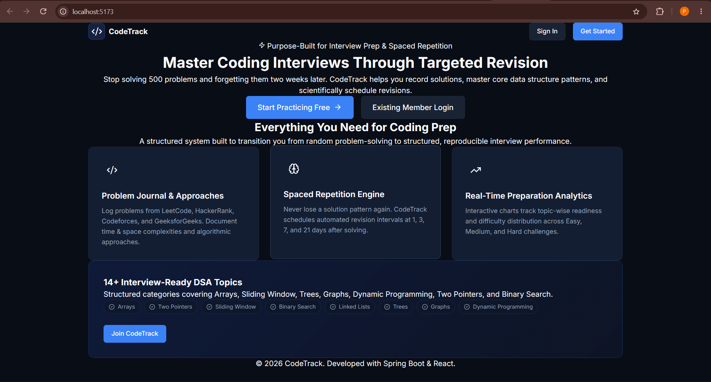
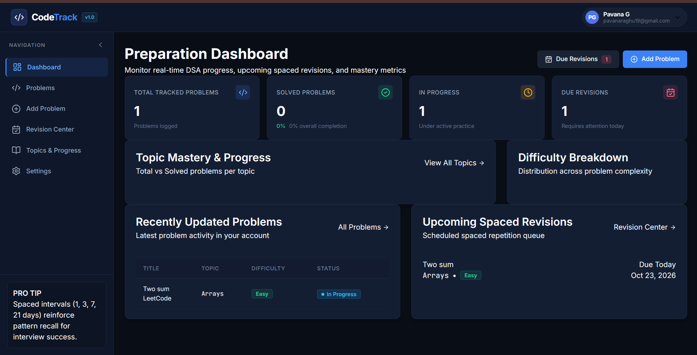
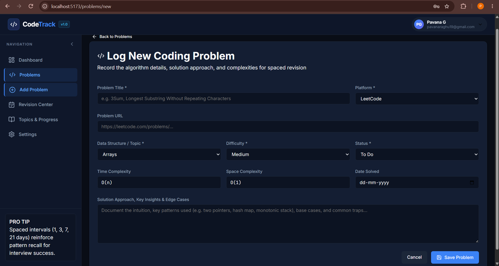
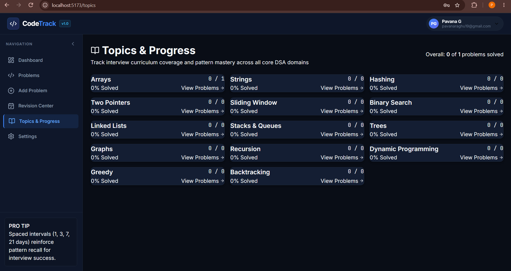

# CodeTrack — Coding Practice and Revision Management Platform

[](https://www.oracle.com/java/)
[](https://spring.io/projects/spring-boot)
[](https://react.dev/)
[](https://www.mysql.com/)
[](LICENSE)

# CodeTrack — Coding Practice & Revision Platform

CodeTrack is a full-stack web application designed to help developers organize coding practice, track problem-solving progress, and revise previously solved problems. It provides a centralized platform for managing coding problems, monitoring progress, and maintaining consistent practice.

## Features

- **User Authentication:** Secure registration and login using JWT-based authentication.
- **Problem Management:** Add, view, update, and delete coding problems.
- **Topic Organization:** Organize coding problems by topic for structured practice.
- **Progress Tracking:** Track solved problems and monitor coding practice progress.
- **Dashboard:** View an overview of coding activity and progress.
- **Revision Management:** Review previously solved problems for better retention.
- **Responsive Interface:** Access the application through a clean, user-friendly interface.

## Screenshots

### Landing Page


### Dashboard


### Problem Management


### Topic Management


## Tech Stack

**Frontend**
- React
- JavaScript
- Vite
- Axios
- React Router
- CSS

**Backend**
- Java 17
- Spring Boot
- Spring Security
- JWT Authentication
- Spring Data JPA
- Maven

**Database**
- MySQL

**Tools**
- Git and GitHub
- IntelliJ IDEA
- Postman

## Getting Started

### Prerequisites

Make sure you have the following installed:

- Java 17 or later
- Node.js and npm
- MySQL
- Maven

### 1. Clone the Repository

```bash
git clone <YOUR_GITHUB_REPOSITORY_URL>
cd CodeTrack
```

### 2. Configure the Database

Create a MySQL database and configure the database connection details in the backend application configuration.

Keep your database password and JWT secret private. Do not commit real credentials to GitHub.

### 3. Run the Backend

Open a terminal in the backend directory and run:

```bash
mvn spring-boot:run
```

Ensure the database configuration is correct before starting the application.

### 4. Run the Frontend

Open another terminal in the frontend directory and run:

```bash
npm install
npm run dev
```

Open the local URL displayed by Vite in your terminal.

> **Note:** Run these commands from the directories containing the respective backend `pom.xml` and frontend `package.json` files.

## Project Structure

```text
CodeTrack/
├── backend/          # Spring Boot backend
├── frontend/         # React frontend
├── database/         # Database schema
├── screenshot/       # Application screenshots
├── README.md
└── INTERVIEW_GUIDE.md
```

## Future Enhancements

- Integration with coding platforms
- Advanced practice analytics
- Personalized revision recommendations

## Author

**Pavana G.**
